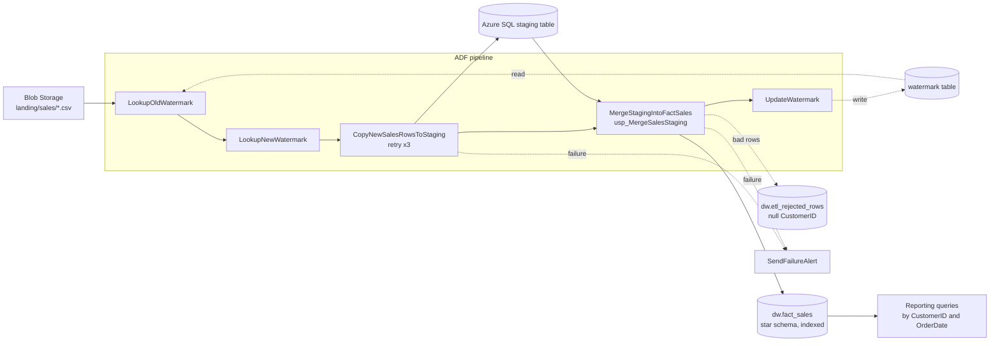

# Cloud-Based Batch ETL Pipeline (Azure Data Factory + Azure SQL)

A batch ETL pipeline design for daily sales transaction data: Blob Storage
CSV drops → Azure Data Factory (watermark-driven incremental copy) → Azure
SQL Database, landing into a star schema with indexes tuned for the
reporting queries built on top of it.

## What's in this repo

Azure Data Factory pipelines are normally built in ADF Studio's visual
designer, not hand-written — but everything you build there is backed by
JSON definitions, which is what's committed here (the same
"pipeline-as-code" representation ADF exports via Git integration / ARM
templates).

```
adf/    Linked services, datasets, and the pipeline definition (JSON)
sql/    Star schema DDL, staging + watermark tables, MERGE stored procedure
local_demo/   A runnable, engine-agnostic proof of the cleaning logic and
              the index performance results below (SQLite standing in for
              Azure SQL, since this is a personal project without an Azure
              subscription to run the real thing against)
```

## Pipeline design



This is the standard ADF watermark-based incremental-copy pattern: only
source rows newer than the last successful run's watermark get copied each
day, rather than re-copying the full history. `dw.usp_MergeSalesStaging`
(see `sql/03_merge_procedure.sql`) is where the actual data-quality work
happens — the same three problems handled in the companion Databricks
project, solved here in T-SQL instead of PySpark:

- rows with a null/unparseable `CustomerID` are dropped and logged to
  `dw.etl_rejected_rows` (not silently discarded)
- `"3.0"`-style quantity strings are coerced via `TRY_CAST(... AS FLOAT)` → `INT`
- duplicate `TransactionID`s within a batch are collapsed via `ROW_NUMBER()`,
  keeping the last-staged row
- the clean batch is upserted into `dw.fact_sales` via `MERGE`

## Star schema + indexing

`dw.fact_sales` joins to `dim_customer`, `dim_product`, and `dim_date`.
Two nonclustered indexes exist specifically because they're what the
reporting layer actually filters/joins on:

- `IX_fact_sales_CustomerID` — customer-level drill-down reports
- `IX_fact_sales_OrderDate` — date-range reports

See `sql/04_query_performance_demo.sql` for the exact query shapes and how
to reproduce the before/after measurement directly against Azure SQL with
`SET STATISTICS TIME, IO ON`.

## Measuring the query performance improvement without an Azure subscription

This is a personal project, not backed by a live Azure SQL Database, so
the indexing strategy's performance impact is validated against a local
SQLite database built from the identical schema and the identical index
columns (`local_demo/`) rather than asserted without evidence:

```bash
cd local_demo
pip install -r requirements.txt
python run_all.py --days 40   # generates ~250K rows, loads them, benchmarks
```

In local testing at ~250K rows, dropping the two indexes and re-running the same customer drill-down and
date-range queries made them 88-99% slower than with the indexes present. SQLite is not Azure SQL, so read this as
evidence that the index columns match the query patterns, not as an Azure benchmark. Real performance depends on data
volume, cardinality and cache state.

Run `pytest tests/ -v` inside `local_demo/` for the cleaning-logic test
suite (null handling, dedup, type coercion, idempotent re-run).

## Local-only limitation, stated plainly

The `adf/` JSON and `sql/` T-SQL are the actual production design — this is
what you'd deploy to a real Data Factory + Azure SQL Database. They aren't
executable here (Azure Data Factory only runs inside Azure, and the T-SQL
targets SQL Server-specific syntax `Azure SQL` supports that SQLite
doesn't — `MERGE`, `TRY_CAST`, `NVARCHAR`, filtered indexes, etc.).
`local_demo/` exists to make the *logic* runnable and testable end-to-end
without cloud resources, not to suggest SQLite is a substitute for Azure SQL.
