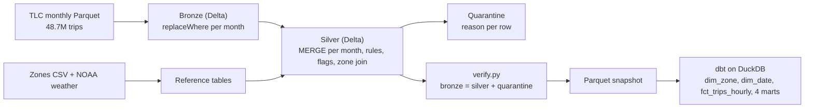

# NYC Mobility: Incremental Multi-Source Pipeline (taxi trips + weather)

[](https://github.com/Murali-152002/Data-engineering-My-Projects/actions/workflows/nyc-mobility-ci.yml)

A monthly, idempotent pipeline over **48.7 million real NYC yellow-taxi trips (all of 2025)**, joined with the TLC zone lookup and daily Central Park weather. Built with PySpark (local mode), Delta Lake `MERGE`, dbt on DuckDB and an Airflow DAG. Every number below was measured on a real run (4-core, ~4 GB Linux VM).

**Honest scope:** single machine, no cloud deployment. Bronze, silver and quarantine are Delta tables. The dbt gold layer reads a Parquet snapshot exported from the Delta silver table (DuckDB cannot read Delta offline here). The Airflow DAG was run end-to-end with `airflow dags test` on a small sample, not scheduled against the full year. Weather comes from one station.

## What this project is about
The point is not the medallion layers, it is **data that keeps arriving and changing**: new months land over time, late rows show up, and values get corrected. The pipeline must absorb all of that without duplicates and without rebuilding everything.



Airflow runs it as `reference > bronze_silver > verify > export_snapshot > dbt_build`, one run per month (`catchup=True`).

## Data
| Source | Rows |
|---|---|
| TLC Yellow Taxi trip records, Jan–Dec 2025 (12 Parquet files) | 48,722,602 |
| TLC taxi zone lookup | 265 zones |
| NOAA daily summaries, Central Park (USW00094728), 2025 | 365 days |

## Results
| Check | Result |
|---|---|
| Bronze → silver + quarantine | 48,722,602 = 47,743,923 + 978,679 (98.0% kept, 2.0% quarantined). Reconciles for every month and re-checked from the actual tables (`src/verify.py`) |
| Duplicate trip keys in silver | 0 |
| Full 12-month load | 936 s (15.6 min) total; a new month takes 78 s on average (44–104 s), about 8% of a full rebuild |
| Late data test (March, simulated) | 20,000 rows withheld + 5,000 rows with stale fares in delivery 1. Delivery 2 (real file) MERGE: **19,380 inserted, 4,938 updated**. Result equals a clean one-pass load: **0 differing rows, 0 duplicate keys**. Replaying delivery 2 again: **0 inserted, 0 updated** |
| dbt | 37 / 37 models and tests pass (keys, not-null, relationships, accepted values, grain, fact reconciles to silver, every trip day has weather) |
| pytest | 7 unit tests on the validation rules + 2 DAG tests |

The late-data test is a simulation: I withheld and altered rows of a real file myself, then delivered the real file. The inserted/updated counts are below 20,000 / 5,000 because some of those rows are quarantined by the rules.

## Data quality (quarantine)
Hard rules send a row to `quarantine` with its reasons; soft rules only flag it in silver.

| Primary quarantine reason | Rows |
|---|---|
| negative total amount (refunds / disputes) | 973,662 |
| dropoff before pickup | 2,235 |
| distance out of range (<0 or >200 mi) | 2,192 |
| duration over 24 h | 352 |
| pickup outside the file's month | 214 |
| duplicate trip key | 24 |

Soft flags kept in silver (not removed): zero passengers 11,701,454 (11.6 M of the 11.87 M raw zero/missing counts are flex-fare rows, which carry no passenger count), zero distance 1,330,039, zero duration 543,943, negative fare 1,879,510, fare over $500: 789.

**A rule I got wrong, and how I found out.** My first version quarantined any row with a negative fare *or* total: 2,858,189 rows (5.9%). Profiling the quarantine by `payment_type` showed 2.05 million of them were `payment_type = 0` (flex-fare) rows, and 1.88 million rows in total had a negative fare but a non-negative total, which are not errors. I changed the rule to reject only negative totals and keep negative fares as a flag, then reloaded all 12 months: quarantine dropped to 978,679. Evidence in `results/rule_change_evidence.json`; a unit test pins the behaviour.

## What the gold layer says (descriptive, not causal)
Average trips per day by weather, split weekday / weekend so day-of-week does not confound:

| | dry | drizzle | rain | snow |
|---|---|---|---|---|
| Weekday trips/day | 128,356 (179 days) | 135,670 (+5.7%) | 137,491 (+7.1%) | 112,743 (-12.2%, 6 days) |
| Weekend trips/day | 128,396 (65 days) | 143,652 (+11.9%) | 138,129 (+7.6%) | 126,517 (-1.5%, 8 days) |

Tips as a share of fare barely move with weather (15.4–15.7% on weekdays). Caveats: one weather station, one year, only 6–8 snow days, no significance testing, seasonality not controlled.

Other marts: the Manhattan congestion-pricing fee (introduced January 2025) appears on 65.8% of January trips and about 72–74% of trips in every later month; top pickup zones are Upper East Side South (2.10 M trips), Midtown Center (2.05 M) and JFK Airport (1.93 M trips at $81.48 revenue per trip). CSV samples are in `results/gold_samples/`.

## What did not work
- **Partitioning did not speed up reads at this size.** On 16.0 M rows, a one-day query took 0.99 s partitioned by month vs 0.65 s unpartitioned (month rollup 0.78 s vs 0.70 s). I partition by month so each MERGE touches one month's files; I did not benchmark that MERGE pruning because the VM ran out of disk for the second copy, so it is a design choice, not a measured win.
- Disk, not CPU, was the limit: shuffle spills and old Delta file versions filled the VM, so I vacuumed old versions and used a lighter benchmark.

## Run it
```bash
pip install -r requirements.txt
# put the 12 monthly files + taxi_zone_lookup.csv + weather_nyc_2025.csv in data_raw/ (see data_raw/README.md)
python src/reference.py
for m in 01 02 03 04 05 06 07 08 09 10 11 12; do python src/pipeline.py 2025-$m; done
python src/verify.py
python src/export_snapshot.py && (cd dbt_project && DBT_PROFILES_DIR=. dbt build)
python src/late_data_test.py 2025-03        # simulated late/corrected data
python -m pytest tests -q
```
Paths are overridable: `NYC_RAW`, `NYC_LAKE`, `NYC_EXPORT`, `NYC_RESULTS`. Delta jars are read from `NYC_JARS` if present, otherwise resolved from Maven Central (CI).

## CI
`.github/workflows/nyc-mobility-ci.yml` (repo root) runs on every push that touches this folder: ruff, pytest, bronze/silver on a 2-month x 20,000-row real-data sample (`data_sample/`), a repeat load plus the Delta MERGE check, the late-data test at small scale, `dbt build`, and an Airflow job that checks the DAG imports and its task order.

## Layout
`src/` pipeline code · `dbt_project/` gold layer · `dags/` Airflow DAG · `tests/` · `results/` measured metrics · `data_sample/` CI sample
