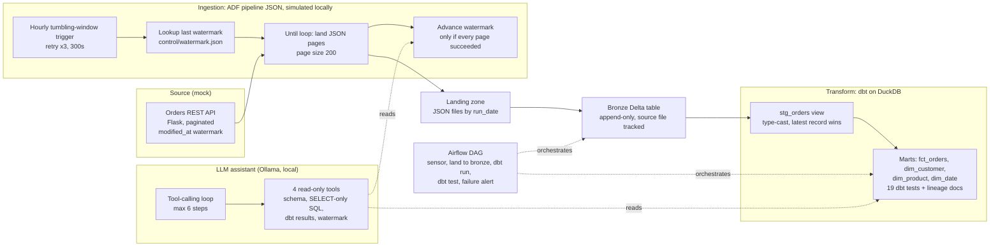

# Orders Lakehouse + LLM Assistant

An incremental REST-API pipeline: Azure Data Factory pipeline-as-code lands paginated JSON, Delta Lake holds the
bronze layer, dbt builds a star-schema mart, Airflow orchestrates the dbt run, and a local-LLM assistant answers
questions about the pipeline through four read-only, guarded tools.

> **Data and runtime:** the source is a mock Flask orders API (400-700 orders/day, 30 days seeded) and everything runs
> locally. Azure services are represented by the ADF pipeline JSON in `adf/` plus the local stand-ins listed below.
> No live Azure subscription was used.

## Architecture



## What each layer proves

| Layer | Tool | How it is checked |
|---|---|---|
| Incremental ingestion | ADF pipeline JSON + local simulation | `tests/test_ingestion.py`: full pagination, rerun pulls 0 rows, watermark unchanged after a mid-page failure, status updates caught |
| Bronze | Delta Lake (delta-rs) | file tracking makes `land_to_bronze.py` safe to call twice |
| Transform | dbt (DuckDB) | 19 tests: primary keys, not-null, fact-to-dimension relationships |
| Orchestration | Airflow | `airflow dags test orders_dbt_orchestration` |
| LLM assistant | Ollama + 4 tools | `tests/test_assistant.py`: DROP/DELETE/multi-statement SQL refused, read-only connection, 50-row cap, step limit |

## Known limitations

- Mock API and synthetic orders, not real business data.
- dbt runs on DuckDB over the Delta files, not a Databricks SQL warehouse.
- No CI pipeline yet; tests run locally with `pytest`.
- The assistant is a single tool-calling loop over one local warehouse, and answer quality depends on the local model.

## Why Airflow orchestrates dbt specifically, not ingestion

ADF already owns ingestion end-to-end on its own Tumbling Window Trigger.
Adding Airflow on top of that same job would just be two orchestrators
doing the same work for no reason. The split here is a genuinely common
real-world pattern instead: ADF for source-to-lake ingestion, Airflow for
orchestrating the downstream dbt transformation run - Airflow triggering
dbt jobs is, in a lot of enterprises, more common than relying on dbt
Cloud's own scheduler. Each tool is doing the job it's actually good at.

## Local substitutes (personal project, no live Azure subscription)

Same honest-substitution pattern as the other two projects in this repo -
real logic, different execution target, clearly labeled:

| Real Azure service | Local stand-in | Why |
|---|---|---|
| Internal REST API | `api_source/mock_orders_api.py` (Flask) | No real internal API to hit; this one has real pagination + a `modified_since` watermark contract, not a toy |
| Azure Data Factory | `local_demo/run_adf_ingestion_simulation.py` | ADF only executes inside Azure; this script runs the *exact* logic described in the pipeline JSON so it's provable, not just described |
| ADLS Gen2 landing zone | `./landing/` folder | Plain filesystem instead of Blob FS |
| Databricks Delta Lake | `deltalake` (delta-rs, zero-JVM) via `ingestion/delta_io.py` | Same substitution used in `multi-source-databricks-etl` |
| Databricks SQL warehouse (dbt target) | DuckDB via `dbt-duckdb`, reading the Delta table's Parquet files directly | A live Databricks SQL warehouse needs an Azure workspace; dbt-duckdb runs the *exact same* dbt models/tests/docs, only the query engine differs |
| Azure Monitor Action Group alert | Log-based alert (`_send_failure_alert` in the DAG) | Same stand-in pattern as the other projects' `send_pipeline_alert` |

The ADF pipeline JSON itself (`adf/`) is the real, deployable artifact - the
same "pipeline-as-code" representation ADF exports via Git integration / ARM
templates, identical in spirit to `cloud-batch-etl-pipeline/adf/`.

## Idempotency & failure-safety, proven not asserted

- The watermark only advances in `AdvanceWatermarkOnSuccess`, which only
  runs if the entire pagination loop succeeded - a failed run never
  advances it, so re-running after a failure safely re-pulls the same
  window instead of silently skipping data.
- `tests/test_ingestion.py` proves this against the real mock API: full
  pagination pulls the correct total, an immediate re-run pulls 0 new rows,
  a simulated mid-pagination failure leaves the watermark untouched, and a
  status-change update (not just a new row) is correctly caught by the
  `modified_at` watermark on the next pull.
- `ingestion/land_to_bronze.py` is separately idempotent on the Bronze side
  via file-tracking (`_source_file`), so calling it twice never double-lands
  the same file - proven by running it back-to-back in the same session.

## Running it

Requires Python 3.10+, Java 11/17 (for Spark, same local-hostname quirk as
the other projects applies: prefix with `SPARK_LOCAL_IP=127.0.0.1` if you
hit a `java.net.UnknownHostException`).

```bash
pip install -r requirements.txt

# 1. Start the mock API (separate terminal, or background it)
cd api_source && python3 mock_orders_api.py &

# 2. Run the ADF pipeline simulation twice - second run proves idempotency
cd ../local_demo && SPARK_LOCAL_IP=127.0.0.1 python3 run_adf_ingestion_simulation.py

# 3. Land Bronze
cd ../ingestion && SPARK_LOCAL_IP=127.0.0.1 python3 land_to_bronze.py

# 4. Run dbt (staging + marts + tests + docs)
cd ../dbt_project
export DBT_PROFILES_DIR=./profiles
export BRONZE_ORDERS_PATH=../warehouse/bronze_orders
dbt run && dbt test && dbt docs generate

# 5. Run the whole thing as one Airflow DAG
cd ..
export PROJECT_ROOT=$(pwd)
export AIRFLOW_HOME=./orchestration/airflow_home
airflow db migrate
cp orchestration/dags/dbt_orchestration_dag.py $AIRFLOW_HOME/dags/
airflow dags test orders_dbt_orchestration $(date +%F)

# Test suite
pytest tests/ -v
```

## Star schema

`fct_orders` (grain: one row per order) joins to `dim_customer`,
`dim_product`, and `dim_date`. `dim_customer` and `dim_product` are built
from observed order activity rather than a separate master data source,
since the mock API only exposes orders - a realistic constraint (not every
project has a clean master-data feed to join against), handled honestly
rather than fabricating a customer/product source that doesn't exist here.

19 dbt tests cover primary-key uniqueness/not-null on every model and
referential integrity (`relationships`) from `fct_orders` to all three
dimensions.

## Pipeline Run Assistant (LLM + tools over the lakehouse)

A small tool-calling assistant that answers plain-English questions about the
pipeline ("how many orders per status?", "did the last dbt run pass?",
"how far has ingestion advanced?") using a **local** LLM through Ollama. No API
key is needed and nothing leaves the machine.

The model never touches the warehouse itself. It can only call four
read-only tools (`assistant/tools.py`):

| Tool | What it does |
|---|---|
| `describe_tables` | lists marts and columns so the model writes valid SQL |
| `run_sql` | one SELECT/WITH query, max 50 rows, DuckDB opened `read_only=True` |
| `last_dbt_run` | summarises `dbt_project/target/run_results.json`, including failed tests |
| `ingestion_status` | reads `control/watermark.json` |

Guardrails (all covered by `tests/test_assistant.py`, which uses a scripted fake
model, so no LLM is needed to run them): DROP/DELETE/INSERT/COPY and
multi-statement queries are refused, the connection is read-only, results are
capped at 50 rows, a refused query is returned to the model as an error instead
of crashing the loop, and the loop stops after 6 steps. Every tool call is
printed so an answer can be checked against the query that produced it.

```bash
# after the dbt steps above have built warehouse/orders_intelligence.duckdb
ollama pull llama3.1
python3 -m assistant.agent "How many orders do we have per status?"
pytest tests/test_assistant.py -v
```

Limits: this is a single-agent tool loop over one local warehouse, not a
production agent platform. Answer quality depends on the local model.
